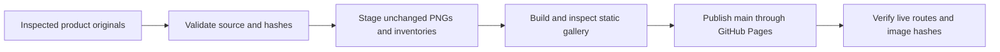

# Material Browser evidence

Browse the [interface gallery](https://ding-ding-projects.github.io/material-browser-evidence/) or read the [evidence method](https://ding-ding-projects.github.io/material-browser-evidence/evidence.html).

The current gallery refresh presents ten inspected original captures of the WorldLens-style desktop at source revision `284fc88f94487a7716099469daadeec258d97b07`. It records an unpackaged Linux Electron run with the production renderer, real main/preload, locally built Rust host and isolated synthetic data. Window bounds, actual CSS viewport and Electron interface zoom are distinct fields. Windows installation, native preference persistence across restart, physical display scaling and audible speaker output are not claimed.

The [22 October historical gallery](https://ding-ding-projects.github.io/material-browser-evidence/archive/2026-10-22/) preserves its eight images, original inventory, pages and capture claims unchanged. Original public image paths also remain present.

## Stage and build

After the product's reviewed source images and sanitized inventories exist, run `node scripts/stage-worldlens.mjs --source <product WorldLens evidence directory>`. The staging command rejects another source revision, unreviewed images, changed PNG bytes or missing dimensions before writing the current inventory. It copies the source inventory, coverage, provenance and runtime summary files without modification.

Run `build.bat` on Windows to create the static site in `site/`. This gallery has no installable application target; `build-installer.bat` intentionally returns failure. A Linux validation may copy `public/` to `site/` and serve those exact static bytes, but that does not establish execution of the Windows batch entrypoint.

Publication and live verification status are tracked in [HANDOFF.md](HANDOFF.md). Preparing source files does not establish that the deployed gallery has changed.

## Publication workflow

